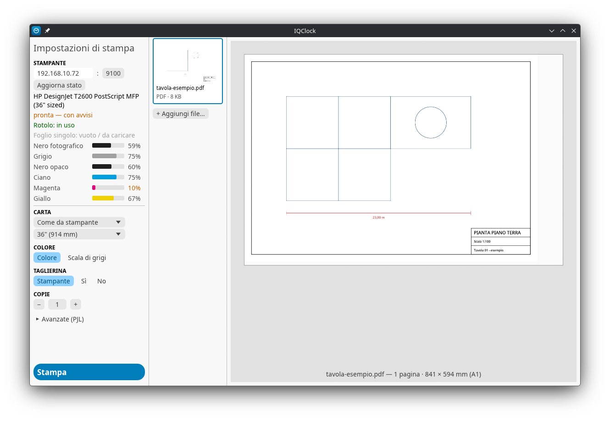

# IQClock

Alternativa minima a HP Click per la DesignJet T2600 PostScript (e in generale per i
DesignJet con interprete PostScript/PDF). Trascini i file, scegli le opzioni, premi
**Stampa**: il file viene mandato così com'è alla porta 9100 con un'intestazione PJL.
Il RIP lo fa la stampante, quindi non serve il motore di HP Click.

Progetto indipendente, non affiliato né approvato da HP. "HP" e "DesignJet" sono marchi
dei rispettivi proprietari e qui compaiono solo per indicare la compatibilità. Il software
è fornito senza alcuna garanzia.



## Uso

- **Download**: [ultima release](https://github.com/CopisteriaTurri/IQClock/releases/latest)
  (`iqclock-win-x64.exe`, `iqclock-linux-x64`). pdfium è già dentro l'eseguibile: al primo
  avvio viene estratto in `%LOCALAPPDATA%\iqclock` (`~/.cache/iqclock` su Linux).
- **Interfaccia**: `iqclock.exe` (oppure trascina i file sull'eseguibile).
  Una `pdfium.dll` messa nella stessa cartella ha la precedenza su quella inclusa.
- **Riga di comando** (su Windows l'output è visibile solo dalla build di debug):
  ```
  iqclock stampa tavola.pdf --copie 2 --rotolo 1 --grigi
  iqclock stampa tavola.pdf --prn prova.prn     # scrive il job su file senza stampare
  iqclock stampa logo.png --allinea centro       # centrato sul rotolo (vedi sotto)
  iqclock stato                                  # stato, inchiostri, carta
  iqclock snmp 1.3.6.1.2.1.43                    # diagnostica SNMP
  ```

Le impostazioni (IP, porta, larghezza rotolo, margine) stanno in `%APPDATA%\iqclock\config.txt`.
Di default: `192.168.10.72:9100`, rotolo 36", margine 5 mm.

Per i PDF la lista mostra quante pagine ci sono per formato (es. `A4: 9  |  A3: 2  |
320 × 450 mm: 1`): i formati ISO A per nome, gli altri con le misure al mm, senza
distinguere verticale e orizzontale. Vicino a **Stampa** c'è il totale dei PDF in coda,
copie comprese.

## Allineamento sul rotolo

Un contenuto più stretto del rotolo può uscire a **sinistra** (default), al **centro** o
a **destra**. Con "Sinistra" il file parte com'è e decide la stampante. Con "Centro" e
"Destra" IQClock manda una pagina già larga quanto il rotolo meno il margine per lato (mai
quanto il rotolo intero: provato il 30/10/2026, la T2600 la mette per il lungo e tira fuori
un foglio di 91 × 93 cm), con il contenuto spostato,
senza comandi PJL proprietari:

- **PDF**: si allarga il MediaBox di ogni pagina attorno al contenuto, che non viene
  toccato: resta vettoriale e le annotazioni restano al loro posto.
- **JPEG, TIFF, PNG**: riscritti in TIFF con una banda bianca fino alla larghezza del
  rotolo, agli stessi DPI del file (dei TIFF multipagina parte solo la prima pagina).
- **PostScript, HP-GL/2**: partono come sono, il controllo si disattiva.

Una pagina così larga la stampante non la ruota più: la rotazione di 90° che
farebbe per risparmiare carta la decide IQClock prima di allargare, con la stessa regola.
Il **margine** (bordo non stampabile per lato) è configurabile, minimo 3 mm;
se non entra nella larghezza utile la pagina parte com'è. L'anteprima mostra il file
impaginato, cioè quello che parte.
Provato sulla T2600 il 30/10/2026 con margine 5 mm (pagina da 904 mm su rotolo da 914):
un PNG 100 × 60 mm centrato e un PDF A5 verticale centrato (ruotato dall'app) escono su
fogli corti, dritti e con la cornice intera.

La **larghezza del rotolo** è quella rilevata dalla stampante via SNMP; se non arriva si
usa quella scelta a mano e, prima di stampare, IQClock chiede conferma. Da riga di comando
in quel caso serve `--larghezza-rotolo MM`.

## Cosa viene mandato alla stampante

```
<ESC>%-12345X@PJL JOB NAME="tavola.pdf"
@PJL SET COPIES=2
@PJL SET MEDIASOURCE=ROLL1        (solo se scelto)
@PJL SET RENDERMODE=COLOR|GRAYSCALE
@PJL SET CUTTER=ON|OFF            (solo se scelto)
@PJL ENTER LANGUAGE=PDF           (POSTSCRIPT, HPGL2; omesso per TIFF/JPEG/PNG)
...file...
<ESC>%-12345X@PJL EOJ NAME="tavola.pdf"
<ESC>%-12345X
```

| Comando | Fonte | Verificato sulla T2600 |
|---|---|---|
| UEL, JOB/EOJ, ENTER LANGUAGE, COPIES, RENDERMODE | HP PJL Technical Reference Manual (2003) | no |
| MEDIASOURCE=ROLL1/ROLL2/AUTO | tabella PJL dei DesignJet XL 3600 | no |
| CUTTER=ON/OFF | driver CUPS per DesignJet, non documentato da HP | no |
| `@PJL INFO STATUS` | manuale PJL | **non supportato**: risponde `"?"` |

I PNG vengono convertiti prima dell'invio: la stampante non li legge dal canale raw,
quindi il file viene riscritto in TIFF RGB 8 bit (LZW con predittore), appiattendo la
trasparenza sul bianco della carta e mantenendo i DPI del chunk `pHYs` (300 se
assenti). Il TIFF vive in un file temporaneo, cancellato quando il job è finito.

Prima di fidarsi delle opzioni, conviene stampare una volta da HP Click o dal driver
Windows "su file" e confrontare l'intestazione PJL che usano.

## Stato della stampante (SNMP v1, community `public`)

Verificato sulla T2600 il 23/10/2026:

| Dato | OID |
|---|---|
| Modello | `1.3.6.1.2.1.25.3.2.1.3.1` (hrDeviceDescr) |
| Stato stampante (3 pronta, 4 stampa, 5 riscaldamento) | `1.3.6.1.2.1.25.3.5.1.1.1` |
| Stato dispositivo (2 ok, 3 avvisi, 5 errore) | `1.3.6.1.2.1.25.3.2.1.5.1` |
| Nomi cartucce | `1.3.6.1.2.1.43.11.1.1.6.1.N` |
| % inchiostro (MIB privata HP) | `1.3.6.1.4.1.11.2.3.9.4.2.1.4.1.5.4.N.1.0` |
| Ingressi carta / stato | `1.3.6.1.2.1.43.8.2.1.13.1.N` / `….11.1.N` |
| Nome supporto letto | `1.3.6.1.4.1.11.2.3.9.4.2.1.4.1.3.3.N.4.0` → "Plain Paper" (riga 1 = rotolo) |
| Larghezza rotolo | `1.3.6.1.4.1.11.2.3.9.4.2.1.4.1.3.3.N.10.0` in decipoint (1/720″): 25920 = 914,4 mm |
| Carta residua sul rotolo | `1.3.6.1.4.1.11.2.3.9.4.2.1.4.1.3.3.N.11.0`, stessa unità (1971554 = 69,6 m) |

Il `prtMarkerSuppliesLevel` standard non è implementato dalla stampante.

La tabella carta standard espone solo nomi e stati: le dimensioni stanno nella
MIB privata HP (passerella PML), verificata il 28/10/2026 contro l'EWS
(`DevMgmt/MediaHandlingDyn.xml`: Roll1 914.400000 mm, restano 69552.065476 mm).
La larghezza mostrata in GUI (`Rotolo rilevato`) e da `iqclock stato` è quella
della riga HP dell'ingresso pronto; se manca (walk vuoti o valori ≤ 0) si usa il
fallback manuale e l'anteprima va su quello. Le stringhe PML hanno due byte
binari di testa che vengono scartati in lettura.

## Limiti del prototipo

- L'anteprima mostra le prime 4 pagine (PDF con pdfium, JPEG, TIFF e PNG); PostScript
  e HP-GL/2 restano senza anteprima.
- Niente nesting o ridimensionamento: decide la stampante.
- Con l'allineamento a sinistra la rotazione di 90° la decide la stampante (impostazione
  del pannello): la T2600 ruota il foglio quando così entra nel rotolo o consuma meno
  carta, e l'anteprima mostra già le pagine come usciranno. Il PJL non la controlla: provato il 29/10/2026,
  `@PJL SET AUTOROTATE=OFF` viene ignorato e `ON` non cambia niente.
- Per le immagini si usano i DPI dichiarati dal file (EXIF/JFIF per JPEG, tag di
  risoluzione per TIFF, chunk `pHYs` per PNG); se mancano o non sono plausibili
  (0, 1, ecc.) si presumono 300 dpi. La lista indica i DPI usati e se sono presunti;
  l'anteprima e le misure in mm seguono quegli stessi DPI.
  Provato sulla T2600 il 29/10/2026: rispetta i DPI del JPEG (solo JFIF o solo EXIF,
  a 72 dpi), del TIFF e del PNG (150 dpi, `pHYs` portato nel TIFF convertito) e, se
  JFIF ed EXIF non coincidono, usa l'EXIF come l'anteprima.
- Nessun controllo che il job sia stato effettivamente stampato: "inviato" vuol dire
  che la stampante ha ricevuto tutti i byte.

## Compilare

```
./scarica-pdfium.sh                                    # pdfium in pdfium/ (non è in git)
cargo build --release --features pdfium-incluso       # Linux
cargo build --release --features pdfium-incluso --target x86_64-pc-windows-gnu   # Windows (serve mingw64-gcc)
cargo test
```

Le icone in `assets/` si rigenerano con `python3 genera-icona.py` (serve Pillow) e sono
in git: `iqclock.png` è quella della finestra e della taskbar, `iqclock.ico` la incorpora
`build.rs` nell'exe Windows (con versione e descrizione del file).
Su Linux, al primo avvio, l'app scrive `~/.local/share/applications/iqclock.desktop` e
l'icona in `~/.local/share/icons/`: sotto Wayland è l'unico modo per avere l'icona nella
barra (altrimenti si vede quella generica), e IQClock compare anche nel menu applicazioni.

pdfium viene da [bblanchon/pdfium-binaries](https://github.com/bblanchon/pdfium-binaries),
release `chromium/7881`: è la versione dell'API per cui è compilato `pdfium-render` 0.9
(feature `pdfium_latest`). Aggiornando il crate va aggiornata anche `VERSIONE` nello script.
Con la feature `pdfium-incluso` (quella delle release) la libreria finisce
nell'eseguibile, che pesa circa 7 MB in più; la licenza di pdfium va distribuita insieme
(`LICENSE-pdfium.txt` nella release). Senza la feature pdfium va messa accanto
all'eseguibile; in debug l'app la trova anche in `pdfium/<piattaforma>` del progetto.

## Licenza

GPL-3.0, vedi [LICENSE](LICENSE).
